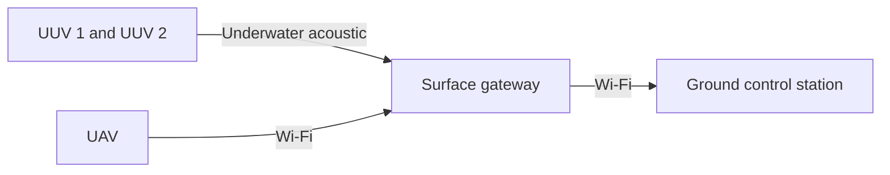

# Acoustic–Wi-Fi gateway simulation

An ns-3.47 starter scenario for the SURF cross-medium communication project. It models a surface gateway receiving data from two underwater nodes and one aerial node and forwarding it to a ground control station. The experiments isolate how acoustic path length affects delay and how a FIFO queue changes delivery during a five-second pause in forwarding.



The gateway receives and relays 64-byte application payloads. In the default run, the fixed underwater nodes are 150 m from the gateway horizontally and 20 m below it. Each source sends one packet per second, staggered across the three sources. The 30-second simulation starts traffic at 2 s and leaves the final 2 s for packets in flight.

## Run the simulation

Install a C++ compiler, Python 3, CMake 3.20 or later, and Ninja. On macOS you can use the Xcode Command Line Tools and Homebrew packages `cmake` and `ninja`. On Ubuntu you can install `build-essential python3 cmake ninja-build curl bzip2`. The [ns-3.47 release page](https://www.nsnam.org/releases/ns-3-47/) provides the upstream source and release details.

Run from this repository in Bash with an unused build directory. This downloads the required simulator and checks the source archive before building the scenario.

```bash
repo_dir="$PWD"
build_dir="$(mktemp -d)"
cd "$build_dir"
curl -fLO https://www.nsnam.org/releases/ns-3.47.tar.bz2
if command -v sha1sum >/dev/null; then
  sha1_tool=(sha1sum)
else
  sha1_tool=(shasum -a 1)
fi
printf '%s\n' '897c3f2db2c6de6a8291e46b3020dbeb1af75269  ns-3.47.tar.bz2' \
  | "${sha1_tool[@]}" -c -
# Continue after the archive check prints OK.
tar -xjf ns-3.47.tar.bz2
cd ns-3.47
cp "$repo_dir/surf-cross-medium.cc" scratch/
./ns3 configure -G Ninja --build-profile=default --enable-modules=uan,wifi,internet --disable-werror
./ns3 build -j 4
mkdir -p out
./ns3 run "scratch/surf-cross-medium --prefix=out/baseline"
```

Run the comparisons from the same ns-3 directory:

```bash
./ns3 run "scratch/surf-cross-medium --distance=50 --prefix=out/d50"
./ns3 run "scratch/surf-cross-medium --distance=300 --prefix=out/d300"
./ns3 run "scratch/surf-cross-medium --outage=true --buffer=0 --prefix=out/no-buffer"
./ns3 run "scratch/surf-cross-medium --outage=true --buffer=64 --prefix=out/with-buffer"
./ns3 run "scratch/surf-cross-medium --rate=3.333333333 --duration=300 --prefix=out/stress-300s"
```

## Results

The [sample output](sample-output/) covers six runs. All distances below are horizontal UUV-to-gateway distances, and the 150 m distance is used unless specified.

| Case | GCS received / generated | Within 1 s of transmission | UUV1 P95 end-to-end delay |
| :--- | ---: | ---: | ---: |
| Baseline, 50 m | 78 / 78 | 78 / 78 | 147.63 ms |
| Baseline, 150 m | 78 / 78 | 78 / 78 | 212.61 ms |
| Baseline, 300 m | 78 / 78 | 78 / 78 | 312.17 ms |
| Forwarding pause, no queue | 63 / 78 | 63 / 78 | 212.61 ms |
| Forwarding pause, 64-packet FIFO | 78 / 78 | 65 / 78 | 4,000.09 ms |
| Stress case, about 10 pkt/s total for 300 s | 986 / 2,960 | 986 / 2,960 | No UUV1 packets delivered |

During the pause from 10 s inclusive to 15 s exclusive, the gateway keeps receiving packets. The no-queue run drops 15 of these arrivals. The FIFO holds them and passes them to the Wi-Fi stack after forwarding resumes. It recovers all 15 in this run, with two extra packets reaching the control station within one second of their respective transmissions. The one-second threshold is an illustrative way to measure how much of the delivery gain arrives in time.

The stress run uses a different fixed traffic schedule. Both underwater flows yield zero gateway receptions, while all 986 UAV packets arrive. The packet log locates the symptom before gateway reception. Establishing its cause would require additional MAC/PHY traces and varying the send phases.

## Validation and limits

On 18 November 2026, the scenario was built from a clean ns-3.47 archive on Apple Silicon macOS using Apple Clang 21.0.0, CMake 4.4.5 and Ninja 1.13.2. All six cases ran successfully. The twelve new CSV files matched the included files byte for byte. A separate check recomputed the summaries and the one-second delivery counts from the 3,350 packet records.

Each run writes `-packets.csv` and `-summary.csv`. Packet IDs are unique within a run. The timestamps share one simulation clock, are in nanoseconds, and use `-1` for unobserved events. Delivery ratio is unique arrivals at the GCS divided by generated packets. Goodput counts application payload bits over the full simulation duration. Mean and nearest-rank P95 use delivered packets only. The end-to-end delay is `gcs_rx_ns - tx_ns`; the gateway queue time is `forward_ns - gateway_rx_ns`. The one-second delivery column above is calculated from the packet CSVs using the full generated count as the denominator.

The UAN uses the [native Thorp propagation model](https://www2.nsnam.org/docs/models/html/uan.html) with a fixed 1,500 m/s sound speed and a single impulse arrival. The RF link uses 5 GHz 802.11ac with Friis loss. Results apply to fixed nodes and the given send phases. Multipath, Doppler, real sea conditions and field measurements remain outside this evaluation. The outage pauses application forwarding while the simulated Wi-Fi link stays up. The scenario runs in one ns-3 process and leaves SDN/PX4/ROS 2 integration and blockchain auditing to separate work.
